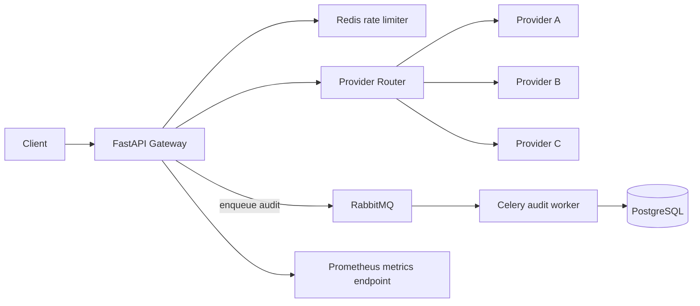

# Provider Gateway

An asynchronous HTTP gateway that accepts a request, selects one of three mock providers, applies backpressure and rate limiting, fails over when an upstream is unhealthy, and asynchronously persists an audit record.

## Quick start

Requirements: Docker Engine and Docker Compose v2.

```bash
docker compose up --build
```

The API is available at `http://localhost:8000`. OpenAPI docs: `http://localhost:8000/docs`.

```bash
curl -i http://localhost:8000/v1/process \
  -H 'Content-Type: application/json' \
  -H 'X-Trace-ID: demo-trace-001' \
  -d '{"payload":{"message":"hello"}}'
```

Optional provider pinning (the router still fails over to the other providers if the preferred provider is unavailable):

```json
{"payload":{"message":"hello"},"preferred_provider":"A"}
```

Health endpoints:

- `GET /health/live` — process liveness.
- `GET /health/ready` — Redis readiness.
- `GET /metrics` — Prometheus metrics.

Stop the stack with `docker compose down`. To remove local database/Redis data too, use `docker compose down -v`.

## Architecture



### Request lifecycle

1. The middleware accepts or generates `X-Request-ID` and `X-Trace-ID` and returns both headers.
2. An atomic Redis fixed-window counter limits aggregate API traffic across API replicas.
3. The provider manager chooses a provider in round-robin order (or tries the requested provider first), enforces a per-process in-flight cap, and makes a non-blocking async HTTP call.
4. Network errors, timeouts, HTTP 5xx, and provider HTTP 429 responses trigger failover to another provider. The router attempts each provider at most once per incoming request.
5. Repeated failures open a per-process circuit breaker for a recovery interval.
6. The API publishes audit metadata to RabbitMQ through Celery. The worker writes it to PostgreSQL independently of the client response path.

## Persistence model

`request_audit` stores request ID (unique/idempotent insert key), trace ID, selected provider, outcome, upstream HTTP status, elapsed time, request/response JSON, error detail, and creation time. Indexes support request lookup, trace lookup, status filtering, and time/provider queries.

Audit events are delivered through RabbitMQ and persisted by Celery workers with retry/backoff. The API does not synchronously wait for PostgreSQL. This reduces database latency in the request path, but means the audit write is eventually consistent. If publishing to RabbitMQ fails, the API logs and increments `gateway_audit_publish_failures_total`; the API response is not failed because of audit persistence. For a stricter audit guarantee, use a transactional outbox (write to a local durable store in the same transaction as business state) or a durable producer-confirmed message publishing design.

## Reliability and scaling notes

- HTTPX uses connection pooling, explicit connect/overall timeouts, and async I/O.
- Per-provider semaphores cap concurrent calls per API process; they prevent one slow provider from consuming all local request capacity.
- Redis rate limiting is atomic across replicas. The included limiter is a global fixed-window policy, not a sophisticated per-tenant token bucket.
- Circuit breaker state and semaphores are currently process-local. In a multi-replica deployment, each replica has its own breaker and in-flight cap. For globally coordinated provider quotas, move provider counters/breaker state to Redis or an API gateway.
- Run one Uvicorn worker per API container and scale API containers behind a load balancer; scale Celery workers independently. This also keeps the default Prometheus process metrics straightforward. PostgreSQL should use connection pooling (for example PgBouncer), partition large audit tables by time, apply retention/archival, and batch writes at higher sustained rates.
- At 1,000–10,000 RPS, benchmark provider capacity first: providers with 1–10 second response times are likely to be the dominant throughput constraint. Increase replicas only with measured provider quotas and concurrency budgets. Avoid unbounded queues; configure RabbitMQ queue limits, alert on queue depth/consumer lag, and apply admission control when the queue is saturated.
- The supplied mock endpoints are public IPs from the task brief. Confirm reachability from the machine running Docker. Do not assume the providers can sustain the target load.

## Configuration

Environment variables and defaults are defined in `app/config.py`. The `.env` file documents the provider URLs and service dependencies. Docker Compose supplies internal service URLs automatically.

Important knobs:

- `SERVICE_RATE_LIMIT` / `SERVICE_RATE_WINDOW_SECONDS`
- `MAX_INFLIGHT_PER_PROVIDER`
- `UPSTREAM_TIMEOUT_SECONDS`
- `CIRCUIT_FAILURE_THRESHOLD` / `CIRCUIT_RECOVERY_SECONDS`

## Benchmarking

Install Locust locally (`pip install locust`) or run it in a separate container, then:

```bash
locust -f locustfile.py --host http://localhost:8000
```

Open `http://localhost:8089`, set users and spawn rate, and run the test. Record:

- achieved requests/second;
- median, average, P95, and P99 response time;
- failure percentage and HTTP status breakdown;
- provider distribution and upstream latency from `/metrics`;
- RabbitMQ audit queue depth and PostgreSQL worker throughput.

A headless run can be captured as CSV:

```bash
locust -f locustfile.py --host http://localhost:8000 \
  --headless -u 100 -r 10 -t 3m --csv=benchmark/results
```

**Benchmark findings:** No benchmark numbers are claimed in this submission. They must be measured from the target environment because provider latency, provider-side rate limits, network path, Docker host resources, and test concurrency materially change the result. Include the generated CSV and a short environment description with your final submission.

## Tests

```bash
docker compose run --rm api pytest -q
```

The included tests cover request schema validation. Add integration tests with mocked HTTP providers and Redis/PostgreSQL containers before treating this as production-ready.

## Known limitations / next hardening steps

1. Add authentication, per-customer quotas, payload size limits, and PII redaction.
2. Move circuit-breaker state and provider concurrency budgets to Redis for cross-replica coordination.
3. Use RabbitMQ publisher confirms and a transactional outbox if audit loss is unacceptable; add dead-letter queues and queue-depth alarms.
4. Replace startup `create_all` with Alembic migrations for production deployments.
5. Add integration/chaos tests for timeouts, 429, 5xx, broker outages, and database outages.
6. Add structured log shipping and dashboards/alerts for error rate, P95/P99, open circuits, in-flight calls, and audit queue lag.
7. Consider adaptive provider weights and a dedicated provider quota policy based on measured provider limits.

This is a runnable technical-assignment baseline, not a claim that 10,000 RPS has been proven. Capacity claims require the benchmark results described above.
